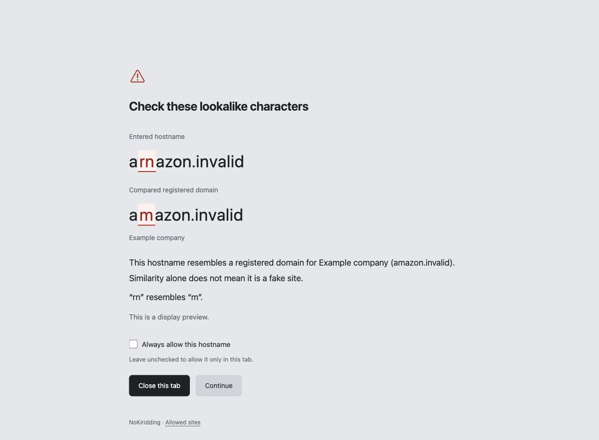
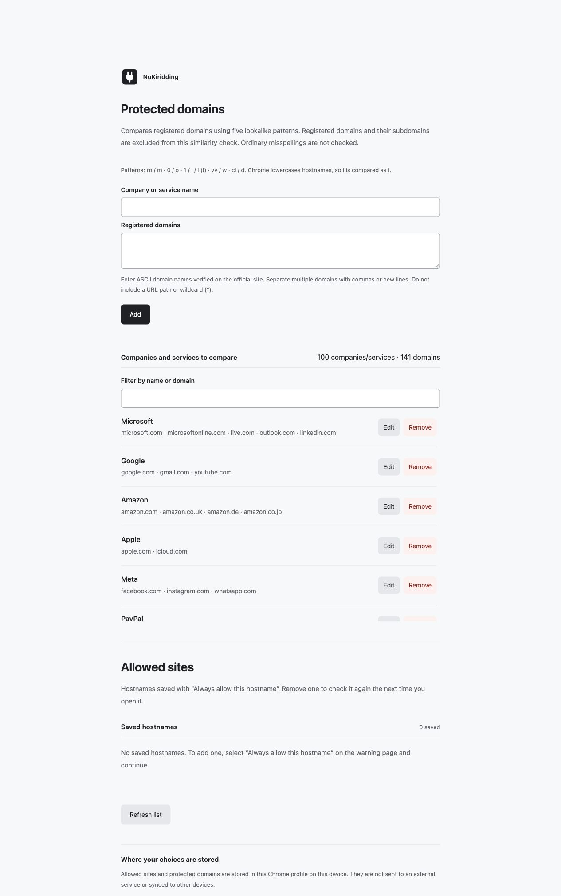
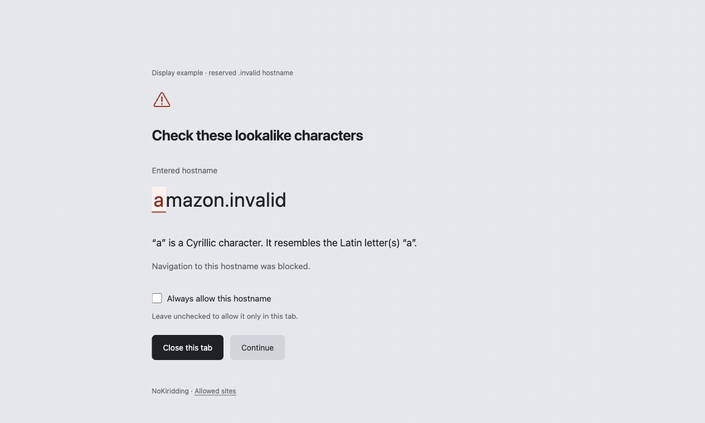
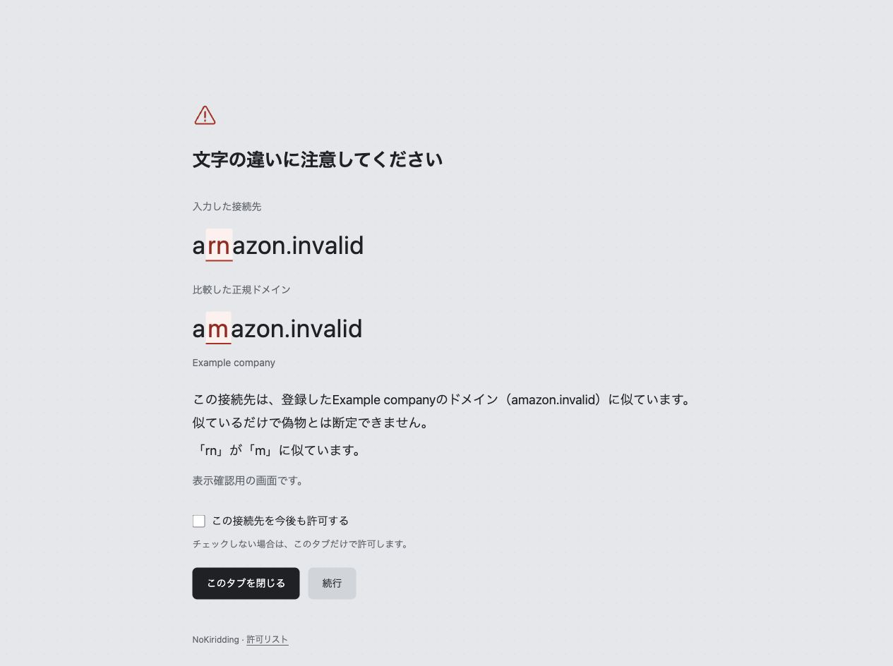
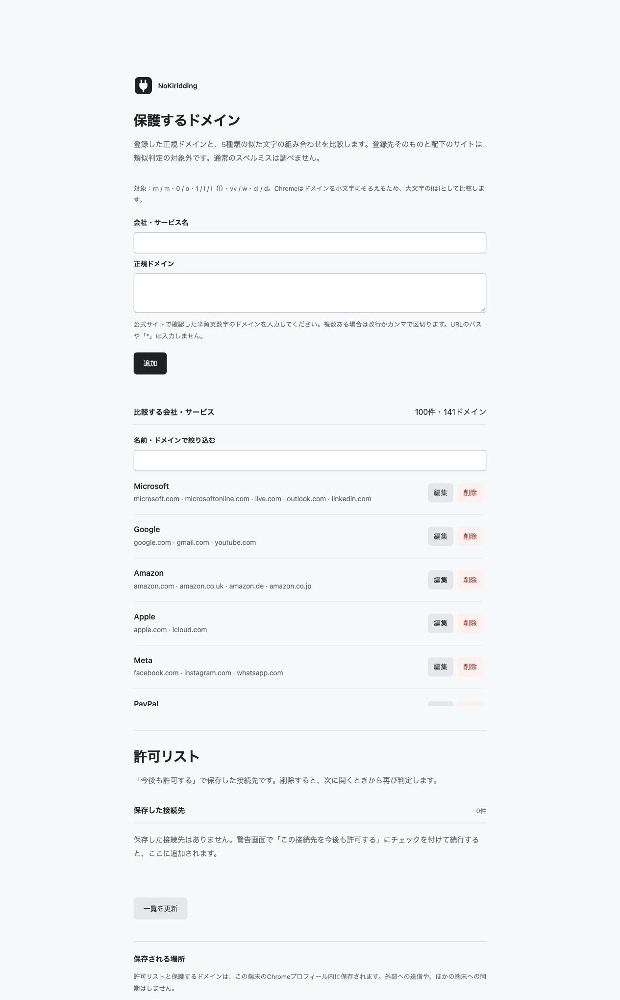
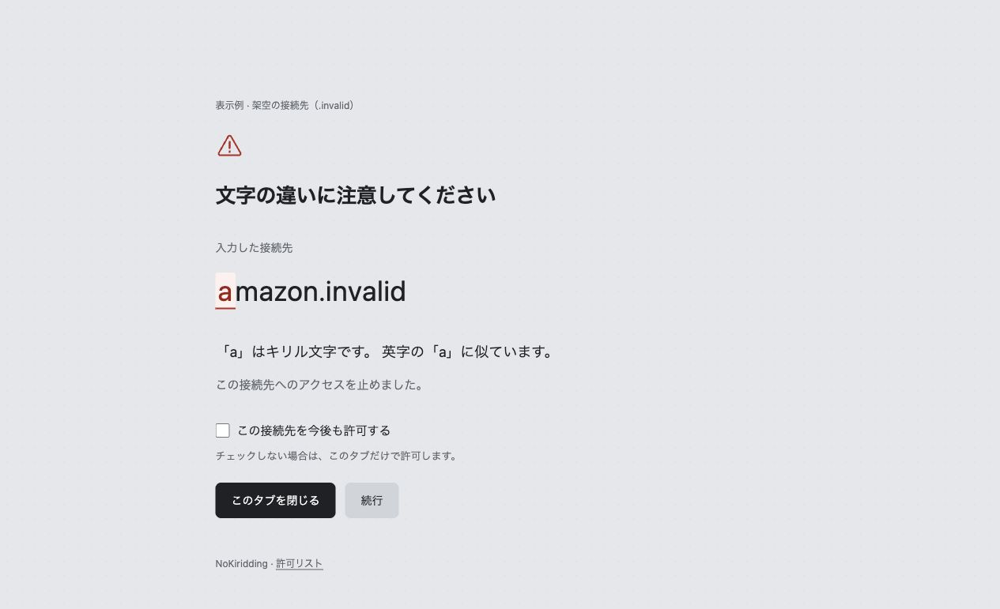

# NoKiridding

[English](#english) · [日本語](#日本語)

## English

NoKiridding is a lookalike-character checker for desktop Chrome. It checks for Cyrillic characters and other listed non-ASCII lookalikes of ordinary Latin letters, stops navigation when a target character is detected, and highlights the character with an explanation.

For example, it detects `аmazon`, where the first character is the Cyrillic `а` rather than the Latin `a` in `amazon`. It does not flag `amazen`, which uses only ordinary Latin letters. **It does not perform general spell-checking. The protected-domain check below covers only five visual patterns.**

### Protected-domain comparisons

Version 0.7.0 adds a second check against an editable initial list of 100 companies/services and 141 domains. It compares five visual patterns: `rn/m`, `0/o`, `1/l/i` (including an entered capital `I`), `vv/w`, and `cl/d`. Chrome lowercases hostnames, so `I` is compared as `i`.

This check applies only when the hostname matches a listed reference through these substitutions, including combinations. Registered domains and their subdomains are excluded from this similarity check. The existing Cyrillic/non-ASCII character check still applies independently. This does not check arbitrary spelling errors, added words, all regional domains, or every form of impersonation. A legitimate site may have a similar name.

The warning compares the entered hostname and the reference on two rows and highlights the differing spans. **Continue** and **Always allow this hostname** remain available; neither verifies safety.

Open the extension icon to view **Protected domains**. Add, edit, remove or filter companies and services. Enter a company/service name and domain names only, separated by commas or new lines. Verify the domains on the official site. Limits: 200 companies/services and 400 domains. Entries are saved only in this Chrome profile; changes do not sync or get sent to a server. Your saved list is retained across updates; new bundled defaults are not merged into a customized list automatically.

[Initial domains and official reference URLs](en/PROTECTED-DOMAINS.csv). This is a manually selected starting list, not a ranking or a measured detection-coverage claim. Websites may host third-party content under otherwise legitimate domains; listing a domain does not prove that every page is safe.

Display-only example using reserved `.invalid` domains and a fictional reference entry. No real site was opened.

These images verify local rendering with development fixtures. The new feature has automated tests, but installed-Chrome blocking, startup and redirects still need a browser check after reloading version 0.7.0.

### Warning screen example

Display example using the actual interface with the reserved hostname `аmazon.invalid`. The first `а` is Cyrillic. This is not a record of visiting a real site.

**This does not block all phishing sites. No warning does not mean a site is safe.** Read the [disclaimer and limitations](en/DISCLAIMER.md) before use.

[Download NoKiridding 0.7.0](https://github.com/46plus-gif/NoKiridding/raw/refs/heads/main/en/NoKiridding-0.7.0-en.zip)

This folder contains the English documentation and a complete copy of the extension. You do not need the Japanese folder.

Version: 0.7.0. Requires desktop Chrome 120 or later. It does not run in mobile Chrome. The interface is Japanese when Chrome's UI language is Japanese, and English otherwise.

[English source files](https://github.com/46plus-gif/NoKiridding/tree/main/en)

### Install from a ZIP

1. Download [NoKiridding-0.7.0-en.zip](https://github.com/46plus-gif/NoKiridding/raw/refs/heads/main/en/NoKiridding-0.7.0-en.zip). Use this extension ZIP, rather than GitHub's automatically generated “Source code” archive.
2. Extract the ZIP and place the extracted folder somewhere you will keep it.
3. Enter `chrome://extensions` in Chrome's address bar.
4. Turn on **Developer mode**.
5. Select **Load unpacked**.
6. Choose the extracted folder that directly contains `manifest.json`. Do not select only its `rules` or `icons` subfolder.
7. Check that **NoKiridding** appears, its version is **0.7.0**, and its switch is on.

Keep the extracted folder in place while using the extension. You may delete the downloaded ZIP. Organization-managed Chrome may prevent this installation method.

These steps follow [Chrome's official unpacked-extension instructions](https://developer.chrome.com/docs/extensions/get-started/tutorial/hello-world#load-unpacked).

### When a warning appears

The warning highlights target characters in red with an underline, and identifies the type of character. Cyrillic characters are flagged even if they do not resemble Latin letters. Legitimate hostnames can therefore trigger a warning.

- Select **Close this tab** to stop.
- After checking the destination, select **Continue** to allow the exact hostname in this tab.
- Select **Always allow this hostname** before continuing to save permission for future visits.

Continuing does not verify safety. An allowed hostname bypasses NoKiridding's character blocking and warnings while that permission is active. Permissions match the exact hostname and do not extend to other subdomains.

Click the extension icon to open **Allowed sites**, where saved permissions can be removed individually. Removing a hostname also revokes its tab-only permissions; already open pages remain open.

### What it checks

For HTTP and HTTPS navigation, it checks only the hostname, including subdomains and the top-level domain. In `https://shop.example.com/page?q=search`, the checked part is `shop.example.com`. Paths, query strings, fragments, credentials and port numbers are outside the character check.

The target characters are:

- All Cyrillic characters.
- Other non-ASCII characters in a bundled list derived from Unicode's confusables data that resemble the Latin letters `a–z` or `A–Z`.

Japanese or Greek text is not blocked solely because of its script, but a character on the lookalike list still triggers a warning. The Unicode data describes visual similarities, not a list of characters confirmed in actual attacks.

If Chrome treats an entry as a Google search, the extension also checks it when the entire search query is shaped like a URL or hostname. This applies only to `/search` on `google.com`, `www.google.com`, `google.co.jp` and `www.google.co.jp`. It hides flagged search results but does **not** prevent the search query from being sent to Google.

ASCII-only domains are checked only through the five patterns and registered references described above. It does not inspect page content, email messages or downloaded files. See the [full limitations](en/DISCLAIMER.md).

### Your data

Saved hostname permissions are stored in this Chrome profile on this device. They do not sync through your Google account. Full destination URLs are held temporarily to support continuing after a warning.

NoKiridding itself does not send checked URLs or allowed sites to an external service. Normal browser requests and Google searches are separate. See the [privacy policy](en/PRIVACY.md).

### Update manually

There is no automatic update mechanism for this ZIP distribution.

1. Pause opening new pages in Chrome.
2. Download the new extension ZIP and extract it separately.
3. Copy its contents into the original installation folder, replacing files with the same names. Keep the installation folder at the same location.
4. Open `chrome://extensions` and reload NoKiridding.
5. Check the displayed version and enabled switch, then use a new tab to check it.

Do not remove the extension to update it if you want to retain saved permissions: removal deletes its stored information. Follow any version-specific update instructions included with a future release.

### Disable or remove

At `chrome://extensions`, switch NoKiridding off to disable it, or select **Remove** to uninstall it and delete its saved information. NoKiridding does not check navigation while disabled or uninstalled.

### License

Original NoKiridding code and documentation are provided under the [MIT License](en/LICENSE).

Copyright (c) 2026 Akapluko.com

Use, modification, commercial use and redistribution are permitted under its terms. Retain the copyright and license notices when redistributing.

Unicode data and derived character mappings have separate terms. Retain [third-party notices](en/THIRD_PARTY_NOTICES.md) and `data/UNICODE-LICENSE.txt`, included in the ZIP.

### Character-data sources

- [Unicode confusables data](https://www.unicode.org/Public/security/latest/confusables.txt)
- [Unicode confusable detection](https://www.unicode.org/reports/tr39/#Confusable_Detection)

Version 0.7.0 bundles its character data. It does not query these sites or automatically update the data during use.

## 日本語

NoKiriddingは、英字にそっくりな別の文字を見つける、パソコン版Chrome用の「偽文字チェッカー」です。対象の文字を見つけると接続を止め、警告画面でその文字と理由を示します。

例えば、`amazon` の先頭の英字 `a` をキリル文字 `а` に置き換えた `аmazon` は検出します。一方、`amazen` のように通常の英字だけで綴りを変えた名前には反応しません。**一般的なスペルミスは判定しません。下記の比較機能では、登録ドメインに対する5種類の見間違いだけを調べます。**

### 保護するドメインとの比較

0.7.0では、編集可能な初期リスト100社・サービス、141ドメインとの比較を追加しました。対象は `rn/m`・`0/o`・`1/l/i`（入力時の大文字 `I` を含む）・`vv/w`・`cl/d` の5種類です。Chromeはドメイン名を小文字にそろえるため、`I` は `i` として比較します。

登録した正規ドメインを、この5種類の置き換えや組み合わせで再現できる場合に警告します。登録先そのものと配下のサイトは、この類似判定から除外します。従来のキリル文字・偽文字の検査は独立して働きます。通常のスペルミス、単語の追加、各社の全地域ドメイン、すべてのなりすましを検出するものではありません。正当なサイト同士でも名前が似る場合があります。

警告画面では入力先と比較先を2行で並べ、違う部分を強調します。「続行」と「この接続先を今後も許可する」も使えます。いずれも安全性を確認する操作ではありません。

拡張機能のアイコンから「保護するドメイン」を開くと、追加・編集・削除・絞り込みができます。会社・サービス名と、公式サイトで確認したドメインを入力してください。複数のドメインは改行かカンマで区切ります。上限は200件・合計400ドメインです。この端末のChromeプロフィール内だけに保存し、外部へ送信・同期しません。編集したリストは更新後も保持し、新しい初期リストを自動で混ぜることはありません。

[初期ドメインと公式参照先の一覧](ja/PROTECTED-DOMAINS.csv)。手動で選定した開始用のリストで、順位や検出率を示すものではありません。正規ドメインの配下に第三者のコンテンツがある場合もあり、登録されていることは全ページの安全性を保証しません。

予約された `.invalid` ドメインと架空の登録情報を使った表示例です。実在サイトには接続していません。

画像は開発用の情報を使ってローカル表示を確認したものです。自動検証は実施済みですが、導入したChromeでの遮断・起動直後・転送時の動作は、0.7.0を再読み込みしてから確認する必要があります。

### 遮断画面の表示例

実際の画面構成を使い、架空の接続先 `аmazon.invalid` を表示した例です。先頭の `а` はキリル文字です。実在サイトへ接続した記録ではありません。

**すべてのフィッシングサイトを防ぐ機能ではありません。警告が出ないことは、安全を意味しません。** 利用前に[免責事項・機能の限界](ja/DISCLAIMER.md)をご確認ください。

このフォルダには、日本語の説明と拡張機能一式が入っています。英語側のフォルダは不要です。

Chromeの表示言語が日本語の場合は日本語、それ以外では英語で表示します。

[NoKiridding 0.7.0をダウンロード](https://github.com/46plus-gif/NoKiridding/raw/refs/heads/main/ja/NoKiridding-0.7.0-ja.zip)

対象バージョン：0.7.0。Chrome 120以降が必要です。スマートフォン版Chromeでは動作しません。

[日本語側のソース一式](https://github.com/46plus-gif/NoKiridding/tree/main/ja)

### 導入する

Chromeウェブストアを使わず、ZIPを展開して手動で導入します。

1. [NoKiridding-0.7.0-ja.zip](https://github.com/46plus-gif/NoKiridding/raw/refs/heads/main/ja/NoKiridding-0.7.0-ja.zip)をダウンロードします。GitHubが自動で用意する「Source code」のZIPとは別です。
2. ZIPを展開し、展開したフォルダを、今後も保管する場所に置きます。
3. Chromeのアドレス欄に `chrome://extensions` と入力して開きます。
4. 右上の「デベロッパー モード」をオンにします。
5. 「パッケージ化されていない拡張機能を読み込む」を押します。
6. 展開したフォルダを選びます。`manifest.json` が直接入っているフォルダです。`rules` や `icons` だけを選ばないでください。
7. 一覧に「NoKiridding」が表示され、バージョンが `0.7.0`、スイッチがオンになっていることを確認します。

導入後も、このフォルダは移動・削除しないでください。ダウンロード用のZIPは削除して構いません。

この方法はChrome公式の[自作の拡張機能を読み込む手順](https://developer.chrome.com/docs/extensions/get-started/tutorial/hello-world#load-unpacked)に基づいています。組織が管理するChromeでは、管理者の設定により導入できない場合があります。

### 警告が出たら

接続先に含まれる対象文字を、赤い文字と下線で示します。キリル文字の場合は、英字に似ていない文字も含めて警告します。正規の接続先でも警告が出ることがあります。

- 接続をやめる：「このタブを閉じる」を押します。
- 接続先を確認して進む：「続行」を押します。そのタブ内で、同じ接続先への移動を許可します。
- 次回からも許可する：「この接続先を今後も許可する」にチェックを付けて「続行」を押します。

許可した接続先は、文字による遮断と警告の対象外になります。「続行」は安全性を確認する処理ではありません。

保存した許可は、拡張機能のアイコンから開く「許可リスト」で1件ずつ削除できます。許可は接続先の名前が完全に一致する場合に適用され、別のサブドメインには広げません。

### 調べる範囲

HTTP・HTTPSの接続先の名前だけを調べます。

例：`https://shop.example.com/ページ名?q=検索` では、`shop.example.com` が判定範囲です。先頭のサブドメインから、末尾の `.com` に相当する部分までを含みます。ページ名、検索条件、ポート番号などは文字判定の対象外です。

対象文字は次のとおりです。

- キリル文字全般。
- Unicode公式の見間違えやすい文字の対応表から抽出した、英字 `a〜z`・`A〜Z` に似た別の文字。

日本語やギリシャ文字という理由だけでは一律に止めません。ただし、上の対応表から抽出した文字に該当すれば警告します。対応表は見た目の類似を示す資料であり、実際の犯罪に使われた文字の一覧ではありません。

Chromeが入力をGoogle検索として扱った場合も、検索内容全体がURLやドメインの形なら判定します。対象は `google.com`・`www.google.com`・`google.co.jp`・`www.google.co.jp` の `/search` です。Googleへの検索送信自体を事前に止める機能ではありません。

英数字だけの接続先は、上記の5種類と登録先に限って比較します。サイトの内容、メール本文、ダウンロードしたファイルは検査しません。詳しくは[免責事項・機能の限界](ja/DISCLAIMER.md)をご確認ください。

### 保存する情報

今後も許可する接続先の名前と管理用の番号は、利用している端末のChrome内に保存します。Googleアカウントを使った別の端末への同期はありません。

警告後に元のページへ進めるよう、完全なURLをChromeの一時保存領域で扱います。NoKiridding自身には、判定したURLや許可リストを外部へ送信する処理はありません。通常のブラウザ操作によるサイトへの通信や、Google検索への送信は別です。詳しくは[プライバシーポリシー](ja/PRIVACY.md)をご確認ください。

### 更新する

自動更新はありません。新しい版が配布されたら、次の手順で更新してください。

1. Chromeで、新しくページを開く操作をいったん止めます。
2. 新しい配布用ZIPをダウンロードし、別の場所へ展開します。
3. 展開した中身を、導入時に読み込んだフォルダへコピーし、同じ名前のファイルを置き換えます。導入済みのフォルダの場所は変えません。
4. `chrome://extensions` を開き、NoKiriddingの再読み込みボタンを押します。
5. バージョン表示が更新されたことと、スイッチがオンになっていることを確認します。確認は新しいタブで行ってください。

許可リストを残す場合、更新のために拡張機能を削除しないでください。削除すると保存情報も消えます。新しい版に別の更新手順が付いている場合は、その手順に従ってください。

### 無効にする・削除する

`chrome://extensions` でNoKiriddingのスイッチをオフにすると無効になります。「削除」を押すと、拡張機能と保存した許可情報が削除されます。無効化中や削除後は、NoKiriddingによる判定は行われません。

### 判定の根拠

- [Unicode公式の見間違えやすい文字の対応表](https://www.unicode.org/Public/security/latest/confusables.txt)
- [Unicodeの文字比較の仕組み](https://www.unicode.org/reports/tr39/#Confusable_Detection)

0.7.0の判定用データは拡張機能に同梱されています。利用中にこれらのサイトへ照会したり、判定用データを自動更新したりすることはありません。

### ライセンス

NoKiriddingの独自のコードと文書は[MITライセンス](ja/LICENSE)で提供します。著作権表示は `Copyright (c) 2026 Akapluko.com` です。利用・改造・商用利用・再配布が可能です。再配布するときは著作権表示とライセンス本文を残してください。

Unicode由来の文字データには別の利用条件が適用されます。[第三者資料の表示](ja/THIRD_PARTY_NOTICES.md)と、ZIP内の `data/UNICODE-LICENSE.txt` を残してください。
